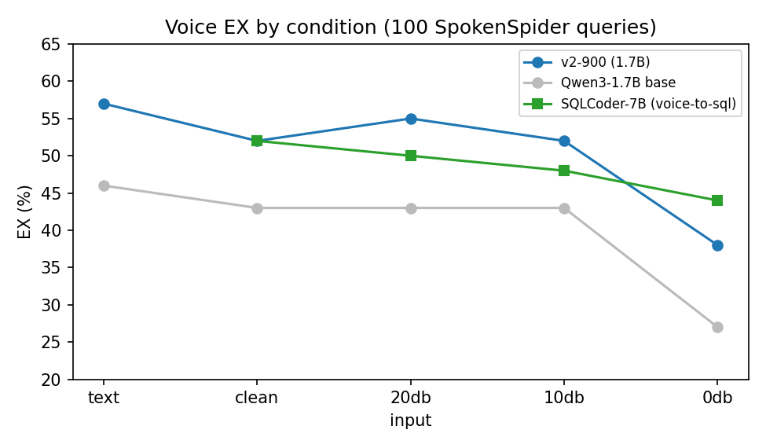
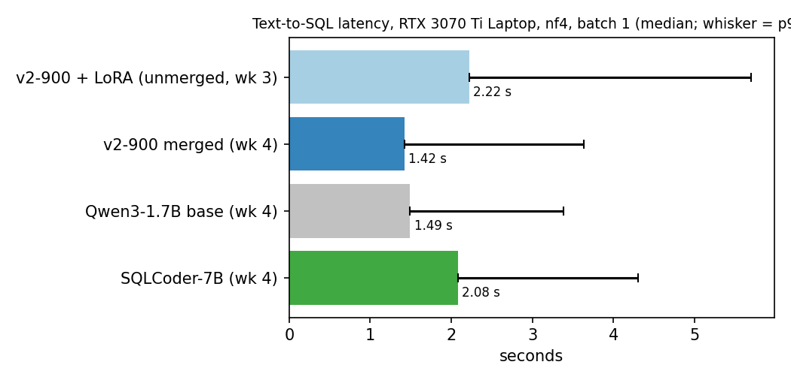

# tiny-sql-rl

**Can a 1.7B model, trained with reinforcement learning on one 8 GB laptop GPU, replace a 7B text-to-SQL
model in a voice pipeline?**

In an earlier voice-to-SQL project, SQLCoder-7B looked like the bottleneck: about 14 s of a ~14 s
query. This project trains Qwen3-1.7B with GRPO on an **execution reward** (does the query return the
right rows?) and measures it against that baseline on accuracy, robustness to ASR noise and latency.

- **Model:** [Alpericon/tiny-sql-rl](https://huggingface.co/Alpericon/tiny-sql-rl) (LoRA adapter, merged bf16, Q8_0 GGUF)
- **Demo:** text or voice, runs locally on CPU: [docs/demo.md](docs/demo.md). A hosted Space was
  not possible: free Gradio Spaces now need a paid plan.
- **Full results with every caveat:** [results/week3_results.md](results/week3_results.md), [results/week4_results.md](results/week4_results.md)

## Results

All accuracy numbers are execution accuracy (EX): greedy decoding, 4-bit, Spider dev (1,034 questions)
unless stated. "Official" is Spider's official evaluation script; "ours" is this project's
column-order-tolerant comparator. Comparisons are paired (exact McNemar on the same questions).
Every training run uses **one seed**, so the tests cover question sampling, not training variance.

### Held-out confirmation: Spider test (week 11)

Every step after GRPO was chosen on Spider dev. So the final configuration was run **once** on the
Spider test set: 2,147 questions on 40 databases that are not in train or dev, released in 2024.
Nothing was tuned on it ([results/week11_results.md](results/week11_results.md)).

| Configuration | Official EX, test | Official EX, dev |
|---|---|---|
| Qwen3-1.7B zero-shot | 56.3% | 54.1% |
| GRPO (released model) | 61.7% | 59.0% |
| + retry on SQL errors + grounding | 64.2% | 60.9% |
| + 3 example rows | 65.7% | 63.4% |
| **+ schema pruning (demo)** | **66.3%** | 65.9% |

- **Confirmed on test:** GRPO (+5.4, 160 / 44) and the whole stack (+10.0 over zero-shot, 308 / 92), both p<0.0001.
- **Same direction but smaller, not significant:** example rows (+1.5, p=0.073) and schema pruning (+0.6,
  p=0.28). Both were chosen because they were significant on dev, and dev overstated them.

### RQ1: does GRPO help?

| Model | EX (ours) | EX (official) | vs zero-shot (wins / losses) |
|---|---|---|---|
| Qwen3-1.7B zero-shot | 53.7% | 54.1% | |
| GRPO, all training questions | 57.1% | 58.1% | 58 / 16, p<0.0001 |
| **GRPO, pass-rate-filtered questions (released)** | **58.5%** | **59.0%** | 84 / 33, p<0.0001 |
| GRPO, filtered, binary reward (ablation) | 58.2% | 58.8% | |
| **released model + one retry on SQL errors** | **60.3%** | **60.8%** | 19 more rescued, 0 lost |
| **+ grounding + 3 example rows per table in the prompt** | **62.2%** | **63.4%** | vs retry + grounding: 72 / 46, p=0.021 (official) |
| same, model trained with example rows (week 8, not released) | 62.8% | 63.9% | vs the row above: 29 / 24, p=0.58 (official) |
| **released model + rows + schema pruning** (week 10, demo default) | **64.1%** | **65.9%** | vs rows without pruning: 42 / 17, p=0.002 (official) |

- **Yes: +4.9 points** (official), significant.
- **The difficulty filter** (train only on questions the base model solves 1–7 of 8 times) cut the
  share of groups with no learning signal from ~65% to 25–41% and made training reward rise.
  But on dev it is **not significantly better** than training on everything (39 / 30, p=0.34).
- **The 0.1 partial credit** for executable-but-wrong SQL made **no difference** (19 / 17).
- **One retry with the error message** (the same repair step SQLCoder's pipeline had) rescues 19 of 133
  failing answers. In 53 of the retries the model just repeats its SQL, since it was never trained on
  multi-turn prompts.
- What still fails is mostly SQL logic. Without repair, 296 of 429 failures return the wrong rows
  and only 10 are format failures.


### RQ2 + RQ4: voice input vs SQLCoder-7B

The test set is 100 SpokenSpider questions (3 databases, never trained on), each read by TTS and
transcribed by ASR at four noise levels. SQLCoder's SQL is the voice-to-SQL project's stored output,
re-scored with the same comparator.

| Input | Qwen3-1.7B base | GRPO model | GRPO + repair | GRPO + repair + grounding | **+ 3 example rows** | SQLCoder-7B (its repair; + grounding) |
|---|---|---|---|---|---|---|
| typed question | 46% | 57% | 58% | 58% | **66%** | (52%; 55%)¹ |
| clean ASR | 43% | 52% | 55% | 59% | **65%** | 52%; 55% |
| 20 dB SNR | 43% | 55% | 57% | 60% | **65%** | 50%; 53% |
| 10 dB SNR | 43% | 52% | 54% | 56% | **61%** | 48%; 51% |
| 0 dB SNR | 27% | 38% | 39% | 40% | **46%** | 44%; 45% |

¹ SQLCoder never saw typed text in that pipeline; its clean-transcript result is shown for reference.
SQLCoder's repair step is voice-to-sql's own (a different prompt and mechanism), not this project's one-retry rule.

- **The 1.7B model ties the 7B model from clean to 10 dB.** With a repair step on both sides it is level
  or ahead (55 vs 52 clean, 57 vs 50 at 20 dB). No per-condition difference is significant (n=100).
- **With 3 example rows in the prompt** (week 7) it is at or above SQLCoder in all five conditions
  (65 vs 55 clean; 46 vs 45 at 0 dB is a tie). Only 20 dB reaches p<0.05, and that is one of five tests, so it is directional.
- **With schema pruning added** (week 10) no condition gets worse: 70 / 68 / 67 / 65 / 46
  (typed, clean, 20, 10, 0 dB), none significantly different alone.
- **Without example rows it degrades more at 0 dB:** −14 points vs −8 for SQLCoder. That gap is
  directional and was not tested.
- **Clean ASR used to cost ~5 points vs typed text.** Transcripts lose literal case (`"Aliens"` → `aliens`),
  so string filters stop matching.
  - **Grounding** fixes this with no training. Before execution it replaces a string literal with the
    database's own value when exactly one value matches it ignoring case and whitespace
    ([results/week6_results.md](results/week6_results.md)).
  - On clean ASR it fixed exactly those 4 queries and broke none (4 / 0; n=100, so not significant on its own).
    Clean speech is now level with typed text (59 vs 58, n=100).
  - Applied to SQLCoder's SQL too, it gains about as much (52 → 55).
  - On typed Spider dev it is neutral (60.3% → 60.4%, 5 / 4). All 4 losses are a Spider quirk: flight_2
    stores city names with a trailing space, so those gold queries return no rows.



### RQ3: latency

RTX 3070 Ti Laptop, nf4, batch 1, 100 clean transcripts:



- **Merged, the 1.7B model is ~30% faster than SQLCoder-7B** at the median (1.42 vs 2.08 s), mostly
  because its answers are shorter. Per token the two 4-bit models are almost equally fast (45 vs 50 ms).
  - The unmerged LoRA adapter doubles the cost per token, so it must be merged for deployment.
- **The bigger finding: the "14 s bottleneck" was not the 7B model.** Re-run with the identical
  prompt and settings (it reproduces 93/100 of the stored SQL), SQLCoder takes 1.8–2.1 s. The
  earlier pipeline's runtime setup was the bottleneck.
  - With either model, the whole voice pipeline is about 2–3 s.
  - So the honest answer to RQ3 is: a small model saves ~0.6 s and ~2.6 GB of VRAM, not ~12 s.
- **On CPU** (the demo's Q8_0 GGUF), a question takes ~1.2–4.8 s plus ~1.5 s of speech-to-text.

## How it works

1. **Data.** Spider train, minus the 100 SpokenSpider questions (leakage filter). Questions whose gold
   result is empty are dropped: a reward-hacking check found the policy getting full reward for any query
   that returns nothing ([results/hack_check.md](results/hack_check.md)).
2. **Difficulty filter.** The base model samples 8 answers per training question. Only questions it
   solves 1–7 times are kept: 1,688 of 6,638.
3. **GRPO.** TRL + Unsloth + vLLM, 4-bit QLoRA r=16. Settings:
   - 8 samples per prompt, 1,000 steps. The released run peaked at 5.75 GiB reserved VRAM and took
     5.3 h of training steps overnight on the laptop (`results/train_log_v2.csv`).
   - Reward: 1.0 if the rows match gold, 0.1 if the SQL runs but is wrong, 0 otherwise.
   - Sandboxed read-only SQLite executor with a timeout.
4. **Selection and evaluation.** The checkpoint is chosen on a 200-question dev subset with a rule fixed
   in advance (best EX, ties to the later step). It is then evaluated on full dev, on the 834 questions
   outside the subset, with the official script, and on voice.
5. **Release.** The adapter is merged into bf16, then exported to GGUF.
   - Q8_0 is shipped. Q4_K_M breaks the model's output format (−12.5 points), so it is not.

## Reproduce

Training and GPU evaluation run in WSL2 (Ubuntu) with CUDA. The demo runs on any CPU.

```bash
bash scripts/setup_wsl.sh                      # training venv (~/venvs/tinysql)
bash scripts/download_spider.sh                # Spider into data/spider/
python scripts/build_exclude_list.py           # SpokenSpider leakage filter
python scripts/check_data.py
~/venvs/tinysql/bin/python scripts/pass_rate.py                                   # difficulty filter (~80 min)
~/venvs/tinysql/bin/python scripts/train_grpo.py --run-name v2 --pass-rate data/train_pass_rate.jsonl
~/venvs/tinysql/bin/python scripts/eval_baseline.py --model Qwen/Qwen3-1.7B --adapter checkpoints/v2/checkpoint-900
bash scripts/setup_official_eval.sh && ~/venvs/officialeval/bin/python scripts/official_eval.py
python scripts/make_figures.py                 # figures from results/ only
```

The planning history is in `SPEC.md` and `PLAN-week1..4.md`. Each week ends with a review gate,
and every number in `results/` comes from a committed script and its output file.

## Limitations

- **One seed per run.** Differences under ~2 points between trained models are not distinguishable
  from training noise. Greedy decoding flips ~15% of answers under small numeric changes, even when
  the averages agree.
- **Spider only, SQLite only, English only.** The voice test covers just 100 questions on 3 databases.
- **Two EX definitions.** The official default removes DISTINCT, which makes it slightly more lenient
  than ours. Both are reported. Our executor cannot read one wta_1 question with broken UTF-8.
- **The demo's speech latency** was measured on short synthetic clips, on a fast laptop CPU.

## Future work

These are ordered by how directly the results above point to them.

1. **Teach the model to use error feedback: tried, null result** ([results/week5_results.md](results/week5_results.md)).
   - In 53 of 133 repair retries the released model repeats the SQL that just failed.
   - A follow-up run (v3) added 500 GRPO steps on a mix of first-turn prompts and "error message →
     corrected SQL" turns, built from the model's own failures on train.
   - On the same 133 failed first attempts, v3 rescued 23 vs 20: **not significant (p=0.45)**.
     About 57% of all training groups (first-turn and repair) had no reward variance, i.e. no learning signal.
   - v3 did score higher on Spider dev overall (62.8% vs 60.8% official with repair). But that is
     confounded with the extra training steps, smaller and not significant outside dev-200 (p=0.054), and it
     was directionally worse on noisy speech.
   - So the released model stays v2-900. Better repair would likely need denser signal, e.g. repair
     prompts filtered to questions where retries sometimes succeed.
2. **Normalise ASR literals: done** (week 6, grounding, see RQ2/RQ4 above). It covers case and whitespace
   only. ASR word errors ("ID" heard as "it") and number formats ("1,000") remain.
3. **More seeds.** Filtered vs unfiltered training is +1.5 points but not significant. Only 2–3 seeds
   per arm can separate a real effect from run-to-run variance.
4. **Schema grounding: first step done** (week 7, [results/week7_results.md](results/week7_results.md)).
   - Showing 3 example rows per table in the prompt, at inference only, raised official EX from 60.9% to 63.4%
     (72 / 46, p=0.021; our metric +1.8, p=0.11).
   - It improved every voice condition (none significantly alone) and put the 1.7B model at or above
     SQLCoder-7B in all five (0 dB tied).
   - The gain is mostly fewer `no such column` errors (74 → 60).
   - Cost: cold CPU latency roughly doubles (5.0 → 9.3 s).
   - **Schema pruning: done** (week 10, [results/week10_results.md](results/week10_results.md)). The first
     attempt shows only the tables a lexical pruner keeps (tuned on train; 98.9% gold-table recall on
     dev). Official EX 63.4% → 65.9% (42 / 17, p=0.002), no voice condition worse, and cold CPU
     latency 9.1 → 6.8 s. The demo prunes by default. A week-9 error analysis
     ([results/error_analysis_wrong_result.md](results/error_analysis_wrong_result.md)) had found 45% of
     wrong results to be schema-linking or join errors.
   - **Training with example rows: tried, null result** (week 8, [results/week8_results.md](results/week8_results.md)).
     The v2 recipe re-run with rows in the prompt (v4) scores 63.9% official vs 63.4% for the released
     model with rows (29 / 24, p=0.58). Voice is higher in all five conditions (+3 to +9, none
     significant after correction), and it keeps the schema-only skill (62.0% vs 60.9%). The release
     stays v2-900. The pass-rate filter was computed without rows, so v4 had less learning signal.
5. **Another benchmark** (e.g. BIRD), to see whether the gains hold beyond Spider.

## License and attribution

- Code: Apache-2.0.
- Base model: [Qwen3-1.7B](https://huggingface.co/Qwen/Qwen3-1.7B) (Apache-2.0).
- Data: [Spider](https://yale-lily.github.io/spider) (Yu et al., 2018; CC BY-SA 4.0); the demo bundles 6 Spider databases.
- Official metric: [test-suite-sql-eval](https://github.com/taoyds/test-suite-sql-eval).
